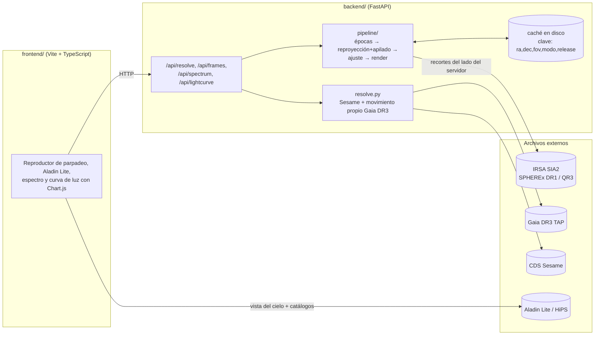

# SPHEREx Blink

**[Read in English](README.md)**

Construido para el [NASA Space Apps Challenge 2026](https://www.spaceappschallenge.org/),
desafío *"Planet X and SPHEREx"* (categoría avanzada). Equipo: 2 personas,
Barranquilla, Colombia.

Ingresa una posición celeste — o simplemente el nombre de una estrella
cercana, una enana marrón o una variable — y SPHEREx Blink busca cada
exposición infrarroja de todo el cielo de [NASA SPHEREx](https://spherex.caltech.edu/)
que cubre ese trozo de cielo, agrupa las exposiciones en épocas de
observación, las alinea y las apila, y las reproduce como una **animación
de parpadeo** ("blink"): el mismo truco que usan los astrónomos desde los
años 1930 para detectar objetos que se mueven o cambian.

## La ciencia detrás de la herramienta

En 1930, Clyde Tombaugh descubrió Plutón "parpadeando" entre dos placas
fotográficas del mismo campo estelar tomadas con días de diferencia, en una
máquina llamada comparador de parpadeo (blink comparator): una estrella que
saltaba entre cuadros tenía que estar moviéndose, y por lo tanto, cercana.
El proyecto moderno de ciencia ciudadana de la NASA
[Backyard Worlds: Planet 9](https://www.zooniverse.org/projects/marckuchner/backyard-worlds-planet-9)
revivió exactamente esta técnica con imágenes infrarrojas de WISE para
encontrar enanas marrones frías y débiles (incluyendo varios de los
objetivos integrados en esta herramienta) que son invisibles para los
relevamientos ópticos pero se revelan por su movimiento en el cielo.

SPHEREx, lanzado en 2025, releva *todo* el cielo en 102 bandas infrarrojas
aproximadamente cada seis meses. Esa cadencia lo convierte en un conjunto
de datos natural para un comparador de parpadeo: una estrella o enana
marrón de alto movimiento propio se desplaza visiblemente entre épocas de
SPHEREx, y una estrella variable cambia de brillo visiblemente en el mismo
lugar. Esta herramienta automatiza el comparador de parpadeo para los datos
de SPHEREx, y agrega un espectro por época (la razón de ser de SPHEREx:
cada píxel tiene una longitud de onda, gracias a sus filtros de variación
lineal) y una curva de luz.

## Qué hace

- Resuelve el nombre de un objeto (Sesame) o coordenadas AR/Dec crudas
  (decimales o sexagesimales).
- Para objetivos nombrados de alto movimiento propio, busca el movimiento
  propio en Gaia DR3 (o, para objetivos demasiado débiles/rojos para Gaia,
  en la literatura publicada) y propaga la posición a la época de
  observación actual de SPHEREx — sin esto, un objetivo que se mueve rápido
  puede salirse de un recorte pequeño en pocos años (ver `DECISIONS.md`
  para los detalles de cómo, y por qué fue más difícil de lo que parece).
- Consulta el servicio SIA2 de SPHEREx en IRSA para cada exposición que
  cubre esa posición, solicita un **recorte del lado del servidor** (nunca
  descarga una exposición completa), agrupa las exposiciones en épocas de
  observación, las reproyecta sobre una grilla común, enmascara píxeles
  marcados y las combina con una media ponderada por varianza.
- Genera vistas de **parpadeo**, **diferencia** (última época − primera
  época), **apilado profundo** y **compuesto RGB** (3 rangos de longitud de
  onda), todas normalizadas con un mismo ajuste asinh/zscale compartido
  para que la reproducción no parpadee por diferencias entre cuadros.
- Extrae un **espectro** (flujo vs. longitud de onda, con la solución real
  de longitud de onda por píxel de los filtros de variación lineal de
  SPHEREx) y una **curva de luz** (fotometría de apertura por época) en
  cualquier posición marcada con clic.
- Ofrece una interfaz web bilingüe (ES/EN), accesible, mobile-first y
  consciente del bajo ancho de banda, con una vista del cielo Aladin Lite
  (superposiciones Gaia DR3 y AllWISE, flecha de movimiento propio), y un
  tutorial integrado de "cómo detectar un objeto en movimiento".

## Arquitectura



`backend/app/config.py` es el único lugar que contiene las URLs base de
IRSA y los nombres de colección — ver "Actualizar a una nueva versión de
datos" más abajo.

## Objetivos de demostración obligatorios

Los cinco están precargados en caché (ver `backend/cache/`, incluido en
este repositorio) para que la demo funcione incluso si IRSA está lento o
no disponible:

| Objetivo | Por qué |
|---|---|
| Estrella de Barnard | El mayor movimiento propio de cualquier estrella conocida (~10,3"/año) |
| Épsilon Indi Ba/Bb | El par de enanas marrones más cercano al Sol |
| WISE 0855-0714 | Una de las enanas marrones más frías conocidas |
| RW Aurigae | Estrella joven variable con un disco circumestelar que se atenúa |
| R Draconis | Variable pulsante tipo Mira |

Más tres objetivos extra elegidos por su visibilidad desde Colombia/cielo
austral y el ángulo de ciencia ciudadana LATAM (razonamiento completo en
`DECISIONS.md`): **Próxima Centauri**, **Luhman 16 AB** y **UGPS 0722-05**.

## Ejecución local

### Backend

```bash
cd backend
python -m venv .venv && source .venv/bin/activate && pip install -r requirements.txt
# o, con uv (los venv de uv no incluyen pip, usa `uv pip` en vez de `pip`):
#   uv venv --python 3.12 .venv && source .venv/bin/activate && uv pip install -r requirements.txt
uvicorn app.main:app --reload --port 8000
```

### Frontend

```bash
cd frontend
npm install
VITE_API_BASE=http://localhost:8000 npm run dev
```

Abre la URL localhost que se imprime. Los 8 objetivos de demostración en la
galería "Explorar" funcionan sin conexión/al instante gracias a la caché
incluida; cualquier otra coordenada o nombre consulta IRSA en vivo (más
lento — un campo con muchas exposiciones puede significar descargar
cientos de exposiciones individuales, que el backend ahora descarga de
forma concurrente, pero una primera consulta sin caché puede tardar de 1 a
3+ minutos).

### Docker Compose (ambos servicios)

```bash
docker compose up --build
```

### Pruebas y linting

```bash
# backend
cd backend && source .venv/bin/activate
pytest -q
ruff check app tests

# frontend
cd frontend
npm run lint   # eslint + tsc --noEmit
```

## Construir la caché para un objetivo nuevo

```bash
cd backend && source .venv/bin/activate
python ../scripts/precache.py --targets barnards-star,proxima-centauri --modes blink,sum
```

## Despliegue

- **Backend**: `backend/Dockerfile` construye una imagen independiente
  (cualquier host al estilo Render/Fly.io que ejecute un Dockerfile
  funciona — expone el puerto `8000`, monta o incluye `backend/cache/`
  para los objetivos de demostración precargados).
  - **Render**: apunta a `backend/Dockerfile`; lo detecta y construye
    automáticamente.
  - **Fly.io** (sin tarjeta de crédito en el nivel gratuito): `backend/fly.toml`
    ya está configurado (nombre de la app, puerto 8000, chequeo de salud en
    `/api/health`) —
    ```bash
    curl -L https://fly.io/install.sh | sh   # instala flyctl, una sola vez
    fly auth login                            # abre el navegador para iniciar sesión
    cd backend
    fly launch --no-deploy                    # solo la primera vez: crea/reclama la app
    fly deploy                                 # construye backend/Dockerfile y lo despliega
    ```
  - **Google Cloud Run**: construye desde el mismo Dockerfile, sin cambios —
    ```bash
    cd backend
    gcloud run deploy spherex-blink-backend \
      --source . \
      --region us-central1 \
      --allow-unauthenticated \
      --port 8000
    ```
- **Frontend**: `frontend/vercel.json` es una build estática de Vite;
  define `VITE_API_BASE` con la URL del backend desplegado al momento de
  construir.

## Actualizar a una nueva versión de datos de SPHEREx

Todo lo específico de la versión de datos vive en `backend/app/config.py`:
`SIA_COLLECTIONS` (los nombres de colección SIA2 de IRSA — confirma los
nuevos con `Irsa.list_collections(servicetype="SIA", filter="spherex")`
antes de cambiar esto), `CUTOUT_URL_TEMPLATE`, y `DATA_RELEASE_TAG` (súbelo
para que las entradas de caché antiguas no se mezclen silenciosamente con
la nueva versión). Luego vuelve a ejecutar `scripts/precache.py`.

## Créditos de datos

- **Imágenes SPHEREx**: NASA/IPAC Infrared Science Archive (IRSA), misión
  SPHEREx (JPL/Caltech).
- **Astrometría / movimientos propios**: Gaia DR3 (ESA/Gaia/DPAC); para
  algunos objetivos demasiado débiles/rojos para Gaia, movimientos propios
  de la literatura publicada (citados por objetivo en
  `backend/app/targets.py`).
- **Catálogos superpuestos**: Gaia DR3, AllWISE (NASA/IPAC).
- **Vista del cielo**: Aladin Lite (CDS, Observatoire astronomique de
  Strasbourg).

## Asistencia de IA

El código de este proyecto fue escrito con [Claude Code](https://claude.com/claude-code)
(Anthropic) bajo la dirección del equipo — cada decisión de acceso a
datos, diseño del pipeline y de interfaz/experiencia de usuario fue
especificada, revisada y verificada por el equipo contra los archivos
reales de IRSA/Gaia (ver `DECISIONS.md` para el razonamiento detrás de
cada una). El concepto (un comparador de parpadeo para SPHEREx), la lista
de objetivos, el enfoque LATAM/accesibilidad y todas las decisiones de
diseño son propias del equipo. Ver `DECISIONS.md` para el registro
completo de qué se decidió y por qué.

## Limitaciones

- Las consultas en vivo (sin caché) sobre campos muy poblados o de
  relevamiento "profundo" pueden tardar de uno a varios minutos en la
  primera solicitud — es latencia del archivo de IRSA a través de
  potencialmente cientos de exposiciones individuales, algo que el caché
  del lado del cliente no puede ocultar con una caché fría.
- El cruce de nombre a Gaia DR3 usa una heurística de brillo/proximidad
  (ver `DECISIONS.md`) ajustada contra los propios objetivos preestablecidos
  de esta herramienta; un nombre de texto libre arbitrario en un campo
  denso podría, en principio, identificarse incorrectamente.
- La propagación de movimiento propio es lineal (plano tangente), no una
  integral completa de movimiento espacial 3D — precisa muy por debajo de
  un píxel de SPHEREx en las líneas de base involucradas aquí, pero no
  apta para astrometría de sub-segundo de arco.
- El modo compuesto RGB necesita al menos 3 de las 6 bandas de detector de
  SPHEREx presentes en el campo consultado; el modo diferencia necesita al
  menos 2 épocas.
- El panel de vista del cielo (Aladin Lite) se degrada con elegancia pero
  depende de un CDN externo (`aladin.cds.unistra.fr`) fuera del control de
  este proyecto. Durante el desarrollo, ese CDN sufrió una caída total
  (cada versión fija de la API bajo `/AladinLite/api/v3/` devolvía un error
  "Page unavailable" de marca propia); la aplicación detecta esto y muestra
  un mensaje breve en ese panel en lugar de romper el resto de la interfaz,
  pero la vista del cielo en sí no está disponible hasta que el CDN se
  recupere. El modo de bajo consumo de datos la omite por completo.
- La construcción de la imagen Docker no se verificó con un `docker build`
  real en este entorno (no hay demonio de Docker disponible); el Dockerfile
  sigue un patrón estándar `python:3.12-slim` + pip-install y debería
  construirse sin problemas, pero considérala revisada y no ejecutada hasta
  confirmarlo.
