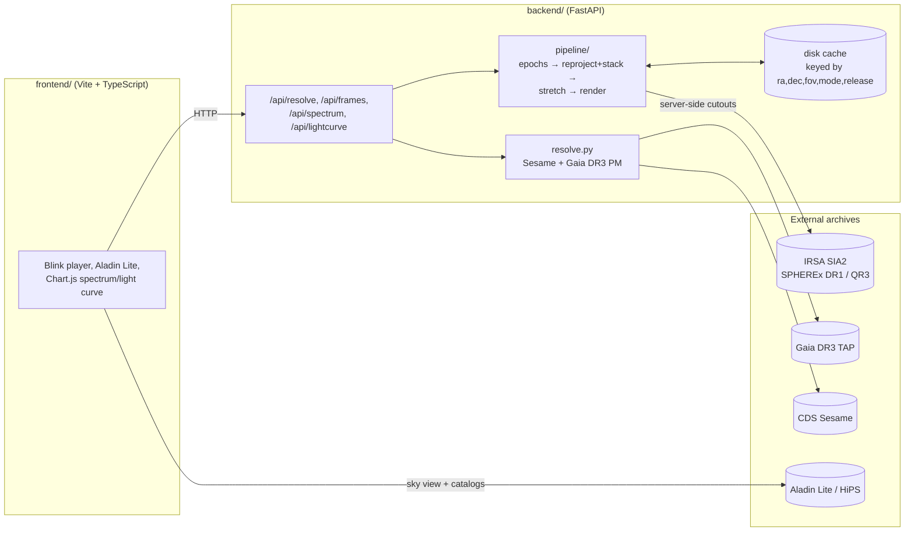

# SPHEREx Blink

**[Leer en español](README.es.md)**

**🔴 Live demo: https://frontend-woad-nu-23.vercel.app** (backend:
https://spherex-blink-backend.fly.dev/api/health)

Built for the [NASA Space Apps Challenge 2026](https://www.spaceappschallenge.org/), challenge
*"Planet X and SPHEREx"* (Advanced track). Team: 2 people, Barranquilla, Colombia.

Enter a sky position — or just the name of a nearby star, brown dwarf, or
variable — and SPHEREx Blink finds every [NASA SPHEREx](https://spherex.caltech.edu/)
all-sky infrared exposure that covers that patch of sky, groups them into
observing epochs, aligns and stacks them, and plays them back as a **blink
animation**: the same trick astronomers have used since the 1930s to spot
things that move or change.

## The science behind it

In 1930, Clyde Tombaugh discovered Pluto by "blinking" between two
photographic plates of the same star field taken days apart on a machine
called a blink comparator — a star that jumped between frames had to be
moving, and therefore nearby. NASA's modern citizen-science project
[Backyard Worlds: Planet 9](https://www.zooniverse.org/projects/marckuchner/backyard-worlds-planet-9)
revived exactly this technique with WISE infrared images to find cold,
faint brown dwarfs (including several of the targets built into this tool)
that are invisible to optical surveys but show up by their motion across
the sky.

SPHEREx, launched in 2025, surveys the *entire* sky in 102 infrared bands
roughly every six months. That cadence makes it a natural blink-comparator
dataset: a high-proper-motion star or brown dwarf visibly shifts between
SPHEREx epochs, and a variable star visibly changes brightness in place.
This tool automates the blink comparator for SPHEREx data, and layers on a
per-epoch spectrum (SPHEREx's whole reason for existing: every pixel has a
wavelength, thanks to its linear variable filters) and a light curve.

## What it does

- Resolves an object name (Sesame) or raw RA/Dec (decimal or sexagesimal).
- For named high-proper-motion targets, looks up Gaia DR3 (or, for targets
  too faint/red for Gaia, a published literature) proper motion and
  propagates the position to the current SPHEREx observing epoch — without
  this, a fast-moving target can drift clean out of a small cutout within a
  few years (see `DECISIONS.md` for exactly how, and why it was harder than
  it sounds).
- Queries IRSA's SPHEREx SIA2 service for every exposure covering that
  position, requests a **server-side cutout** (never a full exposure
  download), groups exposures into observing epochs, reprojects them onto
  one common grid, masks flagged pixels, and combines them with a
  variance-weighted mean.
- Renders **blink**, **difference** (last epoch − first epoch), **sum**
  (deep stack), and **RGB composite** (3 wavelength ranges) views, all
  normalized with one shared asinh/zscale stretch so playback doesn't
  flicker from frame to frame.
- Extracts a **spectrum** (flux vs. wavelength, with the real per-pixel
  wavelength solution for SPHEREx's linear variable filters) and a
  **light curve** (aperture photometry per epoch) at any clicked position.
- Ships a bilingual (ES/EN), accessible, mobile-first, low-bandwidth-aware
  web UI with a side-by-side Aladin Lite sky view (Gaia DR3 + AllWISE
  overlays, proper-motion arrow), and a built-in "how to spot a moving
  object" tutorial.

## Architecture



`backend/app/config.py` is the single place that holds IRSA base URLs and
collection names — see "Updating to a new data release" below.

## Required demo targets

All five are pre-cached (see `backend/cache/`, committed to this repo) so
the demo works even if IRSA is slow or unreachable:

| Target | Why |
|---|---|
| Barnard's Star | Highest proper motion of any known star (~10.3"/yr) |
| Epsilon Indi Ba/Bb | Nearest brown-dwarf pair to the Sun |
| WISE 0855-0714 | One of the coldest brown dwarfs known |
| RW Aurigae | Variable young star with a dimming circumstellar disk |
| R Draconis | Mira-type pulsating variable |

Plus three extras chosen for Colombia/southern-sky visibility and the
LATAM citizen-science angle (full reasoning in `DECISIONS.md`): **Proxima
Centauri**, **Luhman 16 AB**, and **UGPS 0722-05**.

## Running locally

### Backend

```bash
cd backend
python -m venv .venv && source .venv/bin/activate && pip install -r requirements.txt
# or, with uv (uv venvs don't bundle pip, so use `uv pip` instead of plain `pip`):
#   uv venv --python 3.12 .venv && source .venv/bin/activate && uv pip install -r requirements.txt
uvicorn app.main:app --reload --port 8000
```

### Frontend

```bash
cd frontend
npm install
VITE_API_BASE=http://localhost:8000 npm run dev
```

Open the printed localhost URL. The 8 demo targets in the "Explore" gallery
work offline/instantly from the committed cache; any other RA/Dec or name
hits IRSA live (slower — a crowded field can mean fetching hundreds of
individual exposures, which the backend now fetches concurrently, but a
first, uncached query can still take 1-3+ minutes).

### Docker Compose (both services)

```bash
docker compose up --build
```

### Tests and lint

```bash
# backend
cd backend && source .venv/bin/activate
pytest -q
ruff check app tests

# frontend
cd frontend
npm run lint   # eslint + tsc --noEmit
```

## Building the cache for a new target

```bash
cd backend && source .venv/bin/activate
python ../scripts/precache.py --targets barnards-star,proxima-centauri --modes blink,sum
```

## Deployment

- **Backend**: `backend/Dockerfile` builds a standalone image (any
  Render/Fly.io-style host that runs a Dockerfile works — expose port
  `8000`, mount or bake in `backend/cache/` for the pre-cached demo
  targets).
  - **Render**: point it at `backend/Dockerfile`; it auto-detects and builds it.
    Set `SPHEREX_BLINK_CACHE_DIR` only if you want the cache outside the image
    (otherwise the committed `backend/cache/` bakes in).
  - **Fly.io** (no credit card needed for the free tier): `backend/fly.toml` is
    already configured (app name, port 8000, health check on `/api/health`) —
    ```bash
    curl -L https://fly.io/install.sh | sh   # installs flyctl, one time
    fly auth login                            # opens a browser to sign in
    cd backend
    fly launch --no-deploy                    # first time only: creates/claims the app
    fly deploy                                 # builds backend/Dockerfile and ships it
    ```
    `fly launch` will ask to confirm the app name/region from `fly.toml`; say
    yes to reuse what's there. Re-run `fly deploy` for every subsequent update.
  - **Google Cloud Run**: builds from the same Dockerfile, no changes needed —
    ```bash
    cd backend
    gcloud run deploy spherex-blink-backend \
      --source . \
      --region us-central1 \
      --allow-unauthenticated \
      --port 8000
    ```
    `--source .` has Cloud Build build `backend/Dockerfile` directly; swap in
    `gcloud builds submit --tag <region>-docker.pkg.dev/<project>/<repo>/spherex-blink-backend`
    + `gcloud run deploy ... --image <that tag>` if you'd rather build once
    and deploy the resulting image explicitly.
- **Frontend**: `frontend/vercel.json` is a static Vite build; set
  `VITE_API_BASE` to the deployed backend URL at build time.

## Updating to a new SPHEREx data release

Everything data-release-specific lives in `backend/app/config.py`:
`SIA_COLLECTIONS` (the IRSA SIA2 collection names — confirm the new ones
with `Irsa.list_collections(servicetype="SIA", filter="spherex")` before
changing this), `CUTOUT_URL_TEMPLATE`, and `DATA_RELEASE_TAG` (bump this so
old cache entries don't silently mix with the new release). Then re-run
`scripts/precache.py`.

## Data credits

- **SPHEREx imagery**: NASA/IPAC Infrared Science Archive (IRSA), SPHEREx
  mission (JPL/Caltech).
- **Astrometry / proper motions**: Gaia DR3 (ESA/Gaia/DPAC); for a handful
  of targets too faint/red for Gaia, published literature proper motions
  (cited per-target in `backend/app/targets.py`).
- **Catalog overlays**: Gaia DR3, AllWISE (NASA/IPAC).
- **Sky view**: Aladin Lite (CDS, Observatoire astronomique de
  Strasbourg).

## AI assistance

This project's code was written with [Claude Code](https://claude.com/claude-code)
(Anthropic) under the team's direction — every data-access decision,
pipeline design choice, and UI/UX call was specified, reviewed, and
verified by the team against the real IRSA/Gaia archives (see
`DECISIONS.md` for the specific reasoning behind each one). The concept
(a SPHEREx blink comparator), the target list, the LATAM/accessibility
framing, and all design decisions are the team's own. See `DECISIONS.md`
for a full log of what was decided and why.

## Limitations

- Live (non-cached) queries against crowded or "deep"-survey fields can
  take one to several minutes on first request — this is IRSA archive
  latency across potentially hundreds of individual exposures, not
  something client-side caching can hide on a cold cache.
- The name→Gaia DR3 cross-match uses a brightness/proximity heuristic (see
  `DECISIONS.md`) that is tuned against this tool's own preset targets; an
  arbitrary free-text name in a crowded field could in principle be
  mismatched.
- Proper-motion propagation is linear (tangent-plane), not a full 3D
  space-motion integral — accurate to well under one SPHEREx pixel over the
  baselines involved here, but not suitable for sub-arcsecond astrometry.
- RGB composite mode needs at least 3 of the 6 SPHEREx detector bands
  present in the queried field; difference mode needs at least 2 epochs.
- The sky-view panel (Aladin Lite) degrades gracefully but depends on an
  external CDN (`aladin.cds.unistra.fr`) outside this project's control.
  During development that CDN had a full outage (every pinned API version
  under `/AladinLite/api/v3/` returned a branded "Page unavailable" error);
  the app detects this and shows a short message in that panel instead of
  breaking the rest of the UI, but the sky view itself is simply
  unavailable until the CDN recovers. Low-bandwidth mode skips it entirely.
- Docker image build was not verified with an actual `docker build` in
  this environment (no Docker daemon available); the Dockerfile follows a
  standard `python:3.12-slim` + pip-install pattern and should build
  cleanly, but treat it as reviewed-not-executed until confirmed.
