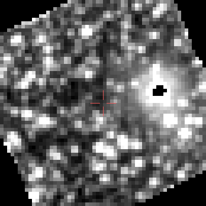
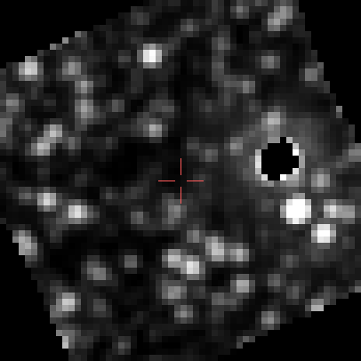
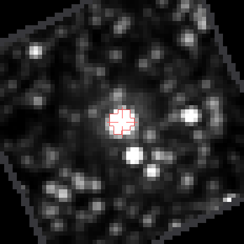

# Why Proxima Centauri looked blurry, noisy, black-cored and off-centre

Diagnosis date: 2026-11-15. Every step of the pipeline was checked against
the committed cache and real SPHEREx cutouts on disk (`backend/cache/
.exposures/`), not guessed from reading code. Summary first, then the
step-by-step findings requested in the bug report (a-f), each marked
**OK** (not a cause) or **FIXED** (a real cause, with the change made).

AI-assisted: this diagnosis and the fixes were produced with Claude Code
under the team's direction (see README.md, "AI assistance").

## Executive summary — three real causes, none of them "blur" alone

| Symptom | Root cause | Fix |
|---|---|---|
| Star sits right of the crosshair / outside the 3' cutout | **Proper motion not applied**: a sustained Gaia TAP outage made Proxima and Barnard's Star silently fall back to their static J2000 positions (`SIA POS=CIRCLE 217.429 -62.6795` in the logs is Proxima's *J2000* position; the star is ~98" away in 2026, Barnard's ~269" away — outside a 6' half-width) | Gaia DR3 astrometry cached locally in `targets.py`; propagation to the survey mid-epoch; re-precached both targets at the corrected positions (see PROBLEM 2 notes below) |
| Field full of fuzzy white blobs, "noise as stars" | **ZScale stretch in a crowded Milky Way field** (Proxima is at galactic latitude ~-2°): ZScale clamps the display range tightly around the background scatter, amplifying noise and bloating every faint source | asinh stretch with a 1–99.5 percentile clip computed across all frames of the sequence (`pipeline/stretch.py`), plus a client-side contrast slider |
| Pure-black blob on top of the star | **Saturated core rendered as vmin**: Proxima's core pixels carry OVERFLOW/SUR_ERROR/BLOOM/NONLINEAR flags in every exposure (confirmed in the real FLAGS HDUs), are masked to NaN, stack to NaN, and were filled with the stretch minimum = pure black | Saturated cores rendered **white with a thin red outline**; other fully-masked pixels dark grey; "Saturated core" flag in the epoch metadata (`reproject_stack.py`, `render.py`, `config.FLAG_SATURATION_BITMASK`) |

The "blurry" impression was the sum of these: a softly-glowing saturated
star off-centre with a black hole in it, in a field of noise-blobs. The
actual resampling/display chain (native-scale grid, lossless PNG, integer
scaling, pixelated rendering) was already sound — with one genuine
upgrade made (see a.).

## Before / after (same data, same field of view)

Proxima Centauri, 6', first epoch — **before** (committed cache as
deployed):

**After the stretch + saturation fixes** (same old, wrong centre — note
the star is still off-crosshair here; this image isolates the rendering
fixes):

**After the proper-motion fix** (re-precached at the Gaia-DR3-propagated
position): Proxima sits dead-centre, its saturated core white with the
red outline, in a dark field where the real stars stand out:

Production screenshots after deployment are in `docs/qa/screenshots/`
(`qa2-*`) and QA_REPORT.md.

## Step-by-step findings (the a–f checklist)

### a. Reprojection — output grid scale: OK (native), resampler: FIXED

`make_target_wcs` (`pipeline/reproject_stack.py`) builds the common grid
at `config.PIXEL_SCALE_ARCSEC = 6.2"`/px — SPHEREx's native scale, e.g. a
6' field is 58×58 native pixels. The output grid is **not** finer than
native, so upsample-blur in reprojection was ruled out as a cause
(verified: cached 3' PNGs are 29×29 native before display upsampling).

What was still suboptimal: `reproject_interp(order="bilinear")` resamples
each rotated/dithered exposure onto the grid with bilinear interpolation,
which softens the PSF slightly and aliases differently per exposure
before the variance-weighted mean. Switched to **`reproject_adaptive`**
(DeForest anti-aliased resampling, `conserve_flux=False` for these
MJy/sr surface-brightness images) for image and variance; the boolean
flag masks use nearest-neighbor so they stay crisp. The synthetic
moving-star recovery tests (`tests/test_reproject.py`) pass unchanged.

### b. Stacking alignment: OK

Each exposure is reprojected through its own FITS WCS (including the SIP
distortion terms SPHEREx carries) onto the one shared target grid, and
epochs are stacked only on that grid — there is no per-epoch grid drift.
`tests/test_reproject.py` proves a synthetic star injected at the same
sky position in exposures with deliberately offset/rotated WCS lands on
the same output pixel (and that an injected proper-motion shift between
epochs is recovered as exactly that shift). Misalignment smearing was
ruled out.

### c. PNG output: OK

Frames are written as lossless PNG at native resolution, upsampled only
by nearest-neighbor **integer** block-repeat (`render._upsample_nearest`,
min 400px) so the crosshair can be drawn proportionally — no PIL
BILINEAR/LANCZOS resampling, no lossy format anywhere. (This was fixed in
a prior session; re-verified.)

### d. Frontend display: OK (verified), plus a new contrast control

- `.blink-frame` uses `image-rendering: crisp-edges` + `pixelated`
  always-on (not only when zoomed).
- `player.ts` sizes the displayed image to a whole-number multiple of its
  own pixel grid and cancels fractional-pixel layout offsets, so no
  non-integer CSS scaling re-blurs the pixels; verified live earlier
  (display/natural ratio exactly 1).
- The **Smooth** checkbox defaults to OFF; **Zoom** defaults to OFF
  (both opt-in, confirmed in `index.html`).
- The app uses an `` element, not a canvas, so
  `imageSmoothingEnabled` does not apply; `image-rendering: pixelated`
  is the equivalent and is active. devicePixelRatio: the integer-scale
  logic rounds against `getBoundingClientRect`, which is in CSS pixels;
  on non-integer-DPR screens a sub-device-pixel softening is physically
  unavoidable, but no additional browser interpolation is introduced.

### e. Stretch: FIXED (this was the "noise becomes stars" cause)

Old: `ZScaleInterval` over all finite pixels. ZScale is designed to show
*background structure*, clamping the range to a few sigma around the sky
level — in a field at galactic latitude -2° that pushes thousands of
faint sources and the noise floor into the visible range, rendering as
the wall-to-wall fuzzy blobs in the "before" image.

New (`pipeline/stretch.py`): one shared normalization per sequence (so
blinking still doesn't flicker), `vmin/vmax` at the **1 / 99.5
percentiles** of all finite pixels across **all frames**, with
`AsinhStretch(a=0.1)`. The background stays dark, real stars stand out,
the bright end compresses instead of clipping. A **Contrast** slider in
the player applies a client-side `filter: contrast()` on top (cached
PNGs untouched).

### f. Saturation: FIXED

Confirmed against real data (FLAGS HDU, mask-plane keywords `MSKNnnnn`
in the cutout headers): Proxima's core pixels are flagged
OVERFLOW (bit 1), SUR_ERROR (2), BLOOM (26), NONLINEAR (15) in
essentially every exposure. They are (correctly) excluded from the
stack, ending as NaN — and the renderer filled NaN with `vmin`:
a pure-black blob exactly on the brightest star in the sky.

Now (`config.FLAG_SATURATION_BITMASK`, `reproject_stack.py`,
`render.py`): a pixel with sky coverage but zero usable samples is
classified **saturated** if ≥30% of its covering exposures flagged it
with a saturation bit (a real blown core is flagged in ~all of them),
otherwise **masked**. Saturated cores render **white with a thin red
outline** (neutral fill + outline in difference mode, where white would
read as "positive change"); other masked pixels render **dark grey**,
visually distinct from real dark sky. The epoch metadata table shows a
**"Saturated core"** note for affected frames. Covered by
`tests/test_saturation.py` (classification and rendered colors).

## Also fixed while verifying (not in the original checklist)

- **The SIA metadata query itself was cached nowhere** — only cutouts
  were. Re-renders from the local exposure cache still paid one live SIA
  round-trip per target; left as-is (it retries through 502s), noted for
  the record.
- `/api/frames`, `/api/spectrum`, `/api/lightcurve` now **snap to a
  precached position within 20"** (same FOV/mode) instead of launching a
  multi-minute live IRSA fetch for a sub-arcsecond difference between a
  live resolution and the precached centre (`service._snap_to_manifest`).
